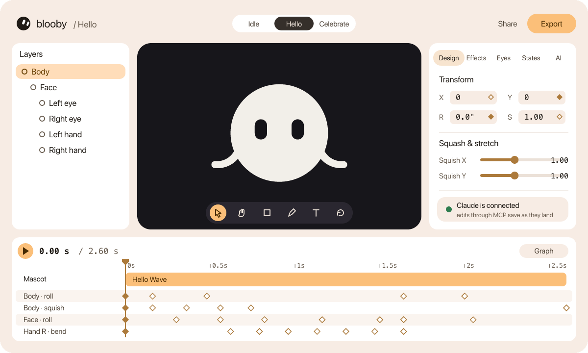
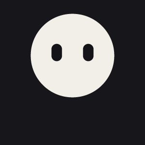

<p align="center">
  
  
</p>

<h1 align="center">Blooby</h1>

<p align="center">
  <b>Build a mascot, animate it, and ship it as a real dotLottie state machine.</b><br />
  A browser studio for character animation: Lottie, <code>.lottie</code>, GIF, MP4, PNG or a React Native component.
</p>

<p align="center">
  <a href="https://github.com/divyanshu-patil/blooby/actions/workflows/ci.yml"></a>
  <a href="./LICENSE"></a>
  
  
</p>

<p align="center">
  
</p>
<p align="center"><sub>The <i>Hello Wave</i> preset from the app mascot kit. The mascot, the layer list, the keyframes and the numbers are the editor's own (<code>pnpm --filter @blooby/api readme:hero</code>).</sub></p>

## What it is

A Blooby mascot is a sphere seen from the front, with features placed on its surface **by angle, not by pixel**.
Drag an eye sideways and it arcs across the face and narrows near the rim, the way it would on a real ball.
On top of that rig sit freeform layers (shapes, SVG, text, drawn curves, rubber-hose hands and legs), a clip
timeline with keyframes, a dotLottie state machine, and a Copilot that edits through the same functions the UI uses.

The editor, renderer and exporters run entirely in the browser. `apps/api` adds accounts, cloud projects, a
community preset catalogue, admin tooling and the MCP server. Without it, the editor still runs offline on
the built-in presets.

## What you can make

| | |
|---|---|
| **Characters** | Several mascots per project, each a body, a **face** layer, eyes and rubber-hose hands and legs that keep their length. Pin a foot or a hand in the world and the limb bends around it. One-click poses, saved mascot templates, roles for any layer |
| **Motion** | Keyframes on every property with Bézier easing and a value graph, squash & stretch, anchor points, procedural shake / float / pendulum / **walk cycle** / follow-through / **jelly** |
| **Layers & looks** | Shapes, pasted SVG, Google Fonts text on an arc or along a path, pen curves with draw-on trim and taper. Glow, blur, shadow, RGB split, slices, scanlines, flicker, jitter, echo and goo, blend modes, masks, gradients |
| **Space** | Layer depth with parallax, card turns, a mascot spinning round its sphere, camera pan / zoom / shake, particle bursts that gather into a word |
| **States** | Each timeline is a state. Rules like *"when `mood == 2`, play Dance"* from any state, in a node graph, exported as a **real dotLottie state machine** |
| **Presets** | 72 built-ins: moods and idles, text, app screens, the app mascot kit, and cinematic ones (Portal Entrance, Full Body Morph, Glitch Materialize, 3D Card Flip, a 20-second showreel). Every part of one is an ordinary layer, key or effect |
| **Copilot** | An agent that inspects, searches presets, edits in small batches, previews and verifies. Every run can be reverted or reapplied |
| **Admin** | Moderation, users, projects, official presets and a splashscreen builder on the editor's own renderer |

### Ship it

| Format | Notes |
|---|---|
| Lottie JSON | Baked per frame from the same scene the canvas draws. Guides are left out. Blend modes, trim offset, flicker, jitter, echo, depth, camera, particles and per-letter motion bake exactly. **Glow, blur, shadow, RGB split, slices, scanlines, goo, gradients and masks have no Lottie equivalent here**: they are drawn in the editor, GIF, MP4 and PNG, and the export lists which layers lost them |
| `.lottie` | Every state in one composition, with markers and the state machine (`s/<id>.json`) |
| React Native pack | The `.lottie`, `blooby.machine.json` and a generated `Mascot.tsx` for `@lottiefiles/dotlottie-react-native` |
| GIF / MP4 / WebM / PNG | Rasterised in the browser. The video container depends on `MediaRecorder` support |

## Showcase

Twelve of the built-in presets, played straight off the renderer. Under each: the systems it is built
from and every property it keys. Open one in the editor and each of these is an ordinary layer, effect,
modifier or keyframe track you can select and change. Nothing in the engine is special-cased for them.

<!-- showcase:start (written by pnpm --filter @blooby/api readme:hero) -->
<table>
<tr>
<td width="33%" valign="top"><br /><b>Portal Entrance</b> <sub>4.0 s</sub><br /><sub>blur · glow · screen blend · gradient · particle burst · camera shake · follow-through</sub><br /><sub><code>transform.scale</code> <code>gradient.angle</code> <code>effect.glow.strength</code> <code>flatOffset</code> <code>transform.rotation</code> <code>squish</code> <code>eye.openness</code> <code>camera.zoom</code></sub></td>
<td width="33%" valign="top"><br /><b>Walk Cycle + Parallax</b> <sub>5.0 s</sub><br /><sub>2.5D depth · blur · rubber-hose limbs · walk cycle · follow-through</sub><br /><sub><code>camera.offset</code> <code>camera.zoom</code> <code>eye.openness</code> <code>transform.rotation</code></sub></td>
<td width="33%" valign="top"><br /><b>Particle Assembly</b> <sub>4.5 s</sub><br /><sub>text · glow · particles that gather · camera shake</sub><br /><sub><code>squish</code> <code>transform.scale</code> <code>transform.rotation</code> <code>text.letterSpacing</code> <code>camera.zoom</code></sub></td>
</tr>
<tr>
<td width="33%" valign="top"><br /><b>Full Body Morph</b> <sub>4.2 s</sub><br /><sub>blur · echo · screen blend · gradient · rubber-hose limbs · particle burst · jelly · follow-through</sub><br /><sub><code>shape.path</code> <code>transform.scale</code> <code>transform.rotation</code> <code>squish</code> <code>limb.b</code></sub></td>
<td width="33%" valign="top"><br /><b>Liquid Splash</b> <sub>4.0 s</sub><br /><sub>goo · glow · gradient · particle burst · jelly</sub><br /><sub><code>flatOffset</code> <code>squish</code> <code>transform.scale</code> <code>effect.goo.radius</code> <code>eye.openness</code></sub></td>
<td width="33%" valign="top"><br /><b>Glitch Materialize</b> <sub>3.6 s</sub><br /><sub>scanlines · rgb split · slices · flicker · mask · gradient · text · camera shake</sub><br /><sub><code>transform.scale</code> <code>effect.slices.amount</code> <code>effect.rgbSplit.amount</code> <code>effect.flicker.amount</code> <code>squish</code> <code>flatOffset</code> <code>surface.yaw</code> <code>eye.openness</code></sub></td>
</tr>
<tr>
<td width="33%" valign="top"><br /><b>Doodle Reveal</b> <sub>4.0 s</sub><br /><sub>drawn curves · jitter · text</sub><br /><sub><code>trim.end</code> <code>trim.offset</code> <code>text.reveal.end</code> <code>transform.rotation</code> <code>transform.scale</code> <code>squish</code> <code>eye.openness</code></sub></td>
<td width="33%" valign="top"><br /><b>BLOOBY Title</b> <sub>5.0 s</sub><br /><sub>text · shadow · glow · particle burst · camera shake</sub><br /><sub><code>text.char.*</code> <code>flatOffset</code> <code>transform.scale</code> <code>squish</code> <code>effect.glow.strength</code> <code>camera.zoom</code> <code>camera.offset</code></sub></td>
<td width="33%" valign="top"><br /><b>3D Card Flip</b> <sub>4.0 s</sub><br /><sub>shadow · gradient · 2.5D depth · particle burst</sub><br /><sub><code>depth.z</code> <code>depth.rotateY</code> <code>depth.rotateX</code> <code>transform.scale</code> <code>flatOffset</code> <code>squish</code> <code>camera.zoom</code> <code>eye.openness</code></sub></td>
</tr>
<tr>
<td width="33%" valign="top"><br /><b>Two Friends</b> <sub>3.2 s</sub><br /><sub>a second mascot</sub><br /><sub><code>flatOffset</code> <code>transform.scale</code> <code>surface.yaw</code> <code>eye.openness</code></sub></td>
<td width="33%" valign="top"><br /><b>Happy Dance</b> <sub>2.8 s</sub><br /><sub>rubber-hose limbs · particles</sub><br /><sub><code>flatOffset</code> <code>transform.scale</code> <code>transform.rotation</code> <code>limb.b</code> <code>limb.c</code> <code>eye.openness</code></sub></td>
<td width="33%" valign="top"><br /><b>Curved Reveal</b> <sub>1.8 s</sub><br /><sub>text on a path</sub><br /><sub><code>text.arc.radius</code> <code>text.chars.kind</code> <code>text.chars.stagger</code> <code>text.chars.progress</code></sub></td>
</tr>
</table>
<!-- showcase:end -->

## Use it from Claude, ChatGPT or Cursor

Blooby is an MCP server. Copy your link from the editor's **AI → Connect AI apps** tab, add it to your AI app
as a connector, approve on the Blooby page it opens, and ask it to animate. Each edit it makes is saved as it
lands and shows up in your open editor. See [docs/mcp](docs/mcp/README.md).

## Quick start

Needs **Node.js 22** and **pnpm 10** (`corepack enable` picks up the pinned version).

```bash
git clone https://github.com/divyanshu-patil/blooby.git
cd blooby
pnpm install
pnpm dev:web      # the editor, offline on the built-in presets: http://localhost:5173
```

```bash
pnpm dev          # web (5173), admin (5174) and api (3000) through Turborepo
pnpm run ci       # lint + typecheck + test: run it before a pull request
```

<details>
<summary><b>Running the backend</b>: environment, the S3 bucket, deploying</summary>

The backend needs a Supabase project, a Postgres connection string and an S3 bucket.

#### Environment variables

Each app has its own `.env.example`. Copy it to `.env` in the same folder. **Frontend
values are shipped in the browser bundle, so put only publishable keys in them.**

| App | Variable | Required | Purpose |
|---|---|---|---|
| `apps/web`, `apps/admin` | `VITE_SUPABASE_URL` | no* | Supabase project URL |
| | `VITE_SUPABASE_PUBLISHABLE_KEY` | no* | Supabase publishable key |
| | `VITE_API_URL` | no* | Where `apps/api` runs, e.g. `http://localhost:3000` |
| `apps/api` | `NODE_ENV`, `PORT` | yes | Runtime mode and port (default `3000`) |
| | `APP_URL`, `ADMIN_URL` | yes | Web and admin origins (CORS) |
| | `SUPABASE_URL`, `SUPABASE_SECRET_KEY`, `SUPABASE_JWKS_URL` | yes | Auth and data. The secret key is server-only |
| | `DATABASE_URL` | yes | Prisma connection. Use the Supabase **transaction** pooler (`:6543`, `pgbouncer=true&connection_limit=10`). Not `connection_limit=1` — that serialises every query in the process onto one connection |
| | `AWS_REGION`, `AWS_S3_BUCKET`, `AWS_ACCESS_KEY_ID`, `AWS_SECRET_ACCESS_KEY` | yes | Project JSON storage (private bucket) |
| | `S3_CORS_ORIGINS` | no | Extra origins for the bucket's CORS rules, beyond `APP_URL` / `ADMIN_URL`. **The bucket needs them** — see below |
| | `ALLOWED_MEDIA_TYPES`, `MAX_PROJECT_BYTES` | yes | Upload limits |
| | `REDIS_URL` | no | Shared rate limits, cache invalidation and MCP state across instances. Unset is fine on one instance — see `docker compose up -d redis`. Needed when a host runs several (Vercel) |
| | `OLLAMA_URL` | no | Upstream for cloud Copilot requests |

\* Leave all three unset in `apps/web` to run the editor offline on the bundled presets.
`apps/api` validates its environment at boot (`src/config/env.ts`) and exits with a
specific message when a value is missing. Copilot API keys are not environment
variables; they are managed from the admin dashboard.

#### The bucket needs CORS rules

The browser reads a project's JSON straight from S3 through a presigned link, instead of
having it proxied through the API — that is what takes two round trips and a median 320KB
off every card on the dashboard. A bucket refuses a cross-origin read by default, so on a
fresh bucket every project fails to open with *"No 'Access-Control-Allow-Origin' header is
present"* until you run:

```bash
pnpm --filter @blooby/api s3:cors            # show what is there, and what would change
pnpm --filter @blooby/api s3:cors --apply    # write it
```

It allows `GET` and `HEAD` from `APP_URL` and `ADMIN_URL`, plus anything in
`S3_CORS_ORIGINS`. CORS is not the access control here — the presigned signature is, and it
names one object and expires within the hour — so listing an origin grants nothing to
anyone who does not already hold a link the API handed them.

(The app survives a bucket without them: it notices, warns in the console, and reads the
document through the API instead. That is several times slower, and it is a fallback, not
the arrangement.)

#### Deploying the API

- **One long-running process** (Render, a VM): `pnpm --filter @blooby/api start`. Redis is optional.
- **Vercel**: `apps/api/vercel.json` installs from the monorepo root and bundles `src/serverless.ts` into one
  file (`scripts/bundle.mjs`). Set `REDIS_URL` there: calls land on different instances, and the MCP server's
  open project, runs, jobs and approvals are shared through it ([docs/mcp/architecture.md](docs/mcp/architecture.md)).

</details>

## How it works

```
UI (ui/*.tsx)  ──►  store actions (core/store.ts, one per mutation, undoable)
                      │
Copilot agent ──► tools (copilot/tools.ts) ─┘  both call core/layers.ts, writeKeyframe, …
                      ▼
               Project (core/types.ts) ─► evaluateRig / buildScene (core/scene.ts)
                                              ├─► <Shapes> (stage, thumbnails, admin splash, raster)
                                              └─► bakeLottie ─► .lottie / React Native pack
```

- **One document shape.** `Project` in `core/types.ts`. Old files are upgraded by
  numbered, append-only steps in `core/migrate.ts`.
- **One renderer.** Preview, thumbnails, the admin splashscreen and every export go
  through `buildScene`, so they cannot drift apart.
- **One property table.** `core/props.ts`.

[AGENT_MAP.md](./AGENT_MAP.md) traces these flows in more detail.

<details>
<summary><b>Editor guide</b>: animation model, mascots, curves, squash, state machines, presets, Copilot</summary>

- **Canvas**: select, move, scale and roll layers directly. Tools: select, hand, shape,
  pen, text and turn (swing a mascot's head). The crosshair inside a selection is its
  anchor. Limb points and curve anchors are dragged in place.
- **Layers**: the hierarchy (Mascot → Face → Eyes and hands, then Legs), draw order,
  grouping and attachment, plus adding mascots, shapes, SVG, text and curves.
- **Inspector**: every property of the selection, each with a keyframe stopwatch. It
  includes Role (make a shape the face), Transform and Anchor, Squish with its presets,
  Leg (Pin to ground), Curve (Start/End offset), Fill and Stroke (hex colour input), and
  Appearance (when the layer is on screen).
- **Timeline**: clips from presets on per-mascot lanes, keyframe lanes and a graph view.
  Select a keyframe to edit its easing curve. On a track's last key, you edit the curve
  arriving at it.

#### Animation model

A project has several **timelines**, and each one is a **state**. A timeline holds clips
(`Block`), keyframe tracks (`Track` → `Keyframe`), procedural modifiers (shake, float,
stretch, pendulum), particle emitters and appearance ranges. A track animates one property
path, such as `transform.rotation`, `squish.x`, `trim.end` or `limb.b.y`. Its keyframes
interpolate with the outgoing key's easing (linear, named presets or a cubic Bézier).
Every animatable property is defined once in `core/props.ts`; the inspector, timeline,
exporters and Copilot all read that table.

#### Mascots, face, hands and legs

A mascot is a `body` node plus parts with roles: `face`, `eyeL`/`eyeR`, `armL`/`armR`,
`legL`/`legR`. Eyes live inside the face, and the face hands the body's sphere down to
them, so eyes still arc when the face moves or turns. Hands ride the face; legs ride the
body. **Pin to ground** records the foot's world position. After that the leg bends
between the moving hip and the planted foot. **Unpin** writes the pinned pose back, so
nothing jumps.

#### Curves and offsets

**Start offset** and **End offset** control which part of a curve's stroke is drawn, as
fractions of its length. Keyframe End from 0 to 1 to draw a line on, then Start from 0 to 1
to draw it off. Start greater than End is allowed and draws the same span reversed. The
Lottie export writes a trim path.

#### Squash & stretch

**Squish X/Y** multiply onto scale, so a squash stacks on top of any scale animation, and
are clamped between 0.4 and 1.8. Set the anchor to the feet ("Squish from: Feet") to keep
a squash on the ground. Squish presets are reusable actions, not clips: **Apply** writes
squish keyframes starting at the playhead, which you can edit like any others.

#### State machines

States are timelines. Inputs are `Boolean`, `Numeric`, `String` or `Event`. The **Rules**
section and its node graph express "when this input condition holds, play this state":

```text
mood == 1 → Happy
mood == 2 → Dance
mood == 3 → Sad
```

A rule applies from **whatever state is current**, so you never wire Idle → Dance,
Happy → Dance and Sad → Dance separately. Drag from **Any state** onto a state in the
graph to add a rule. Drag between two states for a transition out of one state only;
those are tried first. Blend duration, easing and extra conditions are under **More**.
Because dotLottie has no "any state", export fans each rule out into one edge per other
state.

#### Presets

Presets are reusable clips: tracks plus any layers, effects and appearance ranges they
bring. Placing one adds an editable clip on the selected mascot's lane. The library holds
moods and idles, showcase presets (hands, legs, morphs, several mascots), text presets
and app-screen presets, and cinematic presets (`core/cinematicPresets.ts`) built only from
the editor's own systems: effects, masks, depth, the camera, bursts, walk/follow/jelly and
per-letter keys — open one and every part of it is an ordinary layer, key or effect.
`sequence()` joins presets end to end, which is how the showreel is made.

The **app mascot kit** (`core/mascotKit.ts`) holds shippable states for app screens — Writing,
Generation Failed/Cancelled/Complete, Shuffling Cards, Cards Fan Out, Hello Wave, Happy Idle,
Cloud Float (+ Pro), Refresh Release, No Scripts Yet, Telescope Scan, Disconnected, Clap and Bow,
Published!, Listening, Wrong Code, Thumbs Up, Head Scratch, Mail Sent, Sad Goodbye, Hello Jump In,
Sparkle Excited, Cover Eyes. Each is Lottie-safe and its tagline names the `.lottie` and state it
belongs to (`KIT_ASSETS`): make one timeline per state, place the preset, wire the inputs. Users can save
their own, and the community catalogue is served by the API.

A preset layer with a negative `zIndex` is placed behind the whole rig (portals, scenery);
any other sits on top.

#### Copilot

The Copilot runs as an agent loop against Ollama (local, Ollama Cloud or a custom
endpoint):

```
request → inspect project → find functions → search presets → read their keyframes
        → edit in small batches → preview → verify → adjust → finish
```

- **Real editor operations.** Edits go through the same layer and keyframe functions the
  UI uses, and each one is an undo step. `find_functions` lists the edit tools and every
  store action (read from the store's own `Editor` interface), and `call_editor` runs one.
- **Learns from preset data.** `search_presets` matches on what presets actually do
  (hand tracks, squash, trim, curved text, several mascots). `get_preset` returns their
  real layers, keyframe times, values and easings.
- **Observes its work.** `preview` scrubs the playhead and reports where layers are drawn.
  The agent can also move the playhead, select layers and switch inspector tabs.
- **Visible.** A live activity list (status, reads, edits, errors), tokens used, counted as
  the reply streams in (never capped), the step count and elapsed time. Stop cancels the run.
- **Checkpoints.** Each run records the document before and after it. **Revert agent
  decision** restores the before state in one step. **Reapply** restores the recorded
  result without regenerating it.

#### Admin splashscreens

`apps/admin` builds the app's splashscreen from the editor's current project, a published
preset or the default mascot. The preview and the live overlay render with the editor's
`sceneAt` and `<Shapes>`, so every layer type the editor draws also draws there. A preset
is mounted with the editor's own `presetPreviewProject`, which brings its layers, effects
and ranges along with its tracks.

</details>

<details>
<summary><b>Commands and project structure</b></summary>

| Command | What it does |
|---|---|
| `pnpm dev` | All three apps in watch mode (Turborepo terminal UI) |
| `pnpm build` | Production build of every package |
| `pnpm test` | Vitest across the workspace |
| `pnpm lint` | oxlint across the workspace |
| `pnpm typecheck` | `tsc` across the workspace |
| `pnpm run ci` | lint + typecheck + test, what the CI workflow runs |
| `pnpm test:coverage` | Tests with a per-file coverage table |
| `pnpm seed:presets` | Seed the API's preset catalogue from `apps/api/prisma/presets.seed.json` |
| `pnpm --filter @blooby/studio copilot:test -- <model> "<prompt>"` | Run the copilot prompt pipeline against a real Ollama |

```
packages/studio/    the editor, renderer, exporters and copilot: nearly all the logic
  src/core/         data model, store, scene evaluation, layers, mascots, presets, migrations
  src/ui/           stage, layers, inspector, timeline, graph editor, state editor, copilot panel
  src/export/       Lottie baker, dotLottie container, React Native runtime, raster export
  src/copilot/      agent loop, tools, prompt, Ollama client
  src/cloud/        API clients, auth, splashscreen overlay
apps/web/           user-facing shell: auth, dashboard, community, cloud editor
apps/admin/         overview, moderation, users, projects, official presets, splashscreens
apps/api/           Express + Prisma + Supabase (routes → controllers → services → repositories)
supabase/           database migrations
brand/              the icon: vector masters, and what every favicon is generated from
```

`packages/studio/src/index.ts` is the package's only public surface; the apps import from
`@blooby/studio`.

</details>

<details>
<summary><b>The icon</b>: <code>brand/</code> and <code>pnpm icons</code></summary>

`brand/` is the source of truth, and `brand/blooby-icon.icon/` is the Icon Composer project
everything comes out of. The masters are **its own exports** — the real icon, with the
gradient, the sheen and the soft shadow:

| Master | Body | For |
|---|---|---|
| `exports/blooby-icon-2176-dark.png` | near-black | **light** backgrounds |
| `exports/blooby-icon-1088.png` | paper | **dark** backgrounds |

Those effects are why the icon is a raster and not a vector here: they are a *rendering*,
not a shape, and an SVG of the same three shapes is a flatter icon wearing the silhouette.
`blooby-icon-dark.svg` and `blooby-icon-light.svg` keep that flat geometry for the few
places that need a shape rather than a picture, and `geometry.txt` records the numbers —
a circle and two pills tilted 21° at two different sizes — so nobody redraws them by eye.

Everything else is **generated**. `pnpm icons` rebuilds it after any change to a master:

| Generated | From |
|---|---|
| `apps/*/public/favicon-{dark,light}-{32,96}.png` | both colourways; `index.html` picks with `media` |
| `apps/*/public/favicon.ico` (16/32/48) | the dark mark — a bare request has no theme to go on |
| `apps/*/public/apple-touch-icon.png` | dark, on an opaque plate: iOS does not composite transparency |
| `apps/*/public/icon-{192,512}.png` | dark, plated and inset to Android's maskable safe zone |
| `packages/studio/src/kit/blooby-mark.png` | what `BloobyMark` renders in the app |
| `apps/api/src/services/brandMark.ts` | the same bytes as a data URI, for the share cards |
| `brand/exports/mark-{dark,light}-256.png` | the header of this file |

Both apps carry the same mark, so an installed admin panel is told apart from the app by
its name and not by its icon.

```bash
pnpm icons
```

</details>

## Contributing

1. Fork and clone, then `pnpm install`.
2. Branch: `git checkout -b feat/your-change`.
3. Make the change, with tests beside the code you touch.
4. Run `pnpm run ci`, then open a pull request against `main`.

### Tests

```bash
pnpm test                                   # everything
pnpm --filter @blooby/studio test           # editor engine, exporters, copilot
pnpm run ci                                 # lint + typecheck + test
```

Tests sit beside the module they cover (`core/rigging.test.ts`, `copilot/agent.test.ts`).
Studio tests run in Node, written as scripts of assertions (`core/testkit.ts`). The apps
use Testing Library in jsdom. Coverage includes:

- sphere maths
- export against the dotLottie engine's parser contract
- migrations of literal old documents
- every built-in preset: placement, closure and the animation critic
- anchor, squish, face, pinning and trim behaviour
- state rules
- the agent loop with a scripted model
- a cross-feature scenario ending in revert, reapply and a "make it slower" follow-up

<details>
<summary><b>Adding editor functionality</b> (so the UI, the Copilot and MCP stay in sync)</summary>

To keep the UI and the Copilot in sync:

1. **Write the operation once**: a plain function on a `Project` (usually in `core/layers.ts`).
2. **Expose it as a store action** in `core/store.ts` (one `commit`, so it is undoable),
   with a doc comment on the `Editor` interface. The Copilot's `find_functions` reads that
   comment.
3. **Connect the UI** to the store action. Never mutate `project` from a component.
4. **Register a Copilot tool** when the model should call it directly: `TOOL_NAMES`,
   `TOOL_DOCS`, `validate`, `describe` and `applyCalls` in `copilot/tools.ts`.
5. **New animatable property?** Add a row to `PROPS` and a case in `getProp`/`setProp`.
6. **Changed `Project`?** Make the field optional and add a migration step.
7. **Test it** beside the module, and update [COPILOT.md](./COPILOT.md) or this README if
   behaviour changes.

More guidance: [CLAUDE.md](./CLAUDE.md) (codebase map and conventions),
[ASSUMPTIONS.md](./ASSUMPTIONS.md) (decisions and known limits), [DESIGN.md](./DESIGN.md)
(visual language), [ANIMATION.md](./ANIMATION.md) (motion craft behind the Copilot).

</details>

Read [CLAUDE.md](./CLAUDE.md) for the codebase map and conventions, [ASSUMPTIONS.md](./ASSUMPTIONS.md) for
decisions and known limits, [DESIGN.md](./DESIGN.md) for the visual language and [ANIMATION.md](./ANIMATION.md)
for the motion craft behind the Copilot.

## License

[MIT](./LICENSE) © 2026 Divyanshu Patil
